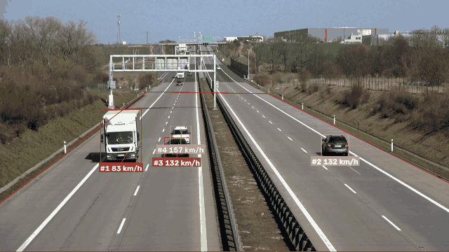
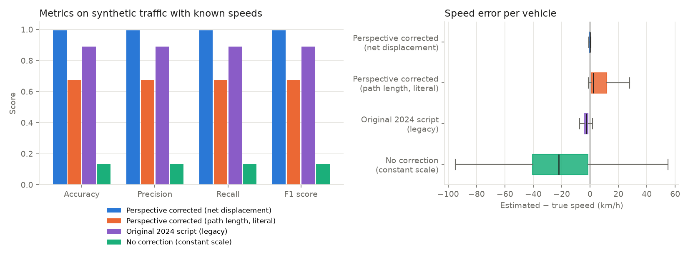

# Vehicle Speed Estimation with Perspective Correction

[](https://doi.org/10.5281/zenodo.23478205)

Code for the manuscript:

> Isogun, O., & Agagu, M. *Enhancing Vehicle Speed Estimation Accuracy Using Computer Vision* [Manuscript]. Department of Computer Science, Olusegun Agagu University of Science and Technology, Nigeria.

A vehicle near a wide-angle traffic camera crosses many more pixels per metre than one far away, so speeds computed from pixel movement are wrong. This pipeline detects vehicles with YOLOv8x, tracks them with ByteTrack, maps each vehicle's ground point onto a metric top-down view of the road with an OpenCV perspective transform, and reports speed as the distance covered in one second.



*Ten seconds of `scripts/estimate_speed.py` output on `vehicles.mp4` (YOLOv8x, corrected speed calculation). Red: the road zone; labels: tracker ID and speed.*

## Results

| Evidence | Result | Scope |
|---|---|---|
| Manuscript, Table 1 | Accuracy 0.80, precision 0.90, recall 0.82, F1 0.86 | 15 vehicles in one clip, scored as correct / incorrect. No measured speeds. Reproduced exactly by `scripts/reproduce_table1.py` |
| Synthetic validation | F1 0.996, mean absolute error 0.31 km/h with perspective correction; F1 0.131, 32.5 km/h without | 480 simulated vehicles with known speeds. An upper bound (see [limitations](#limitations)) |
| Pipeline run on `vehicles.mp4` | 10 vehicles tracked, 83–149 km/h. On the same detections the 2024 calculation reads 5% lower (mean 5.3 km/h) | No ground truth, so this shows how the two calculations differ, not which is right |
| Measured-speed evaluation on real video | Not yet done | Procedure and tooling in [docs/measured-speed-evaluation.md](docs/measured-speed-evaluation.md) |

## Quick start

```bash
git clone https://github.com/TosinISOGUN/traffic-speed-homography.git
cd traffic-speed-homography
python -m venv .venv && source .venv/bin/activate   # Windows: .venv\Scripts\activate
pip install -r requirements.txt

python -m pytest tests               # 16 tests, no video or GPU needed
python scripts/reproduce_table1.py   # recompute the published Table 1
python scripts/run_simulation.py     # synthetic validation
python scripts/download_video.py     # Supervision "vehicles.mp4" -> data/
python scripts/estimate_speed.py     # annotated video and speed logs -> results/video/
```

The YOLOv8x weights (130 MB) download on first run. A GPU is optional: on a CPU, YOLOv8x takes roughly 1–15 s per 4K frame, so the 21-second clip takes a while. Use `--max-frames 100` for a quick look.

## Method

| Step | Manuscript | Code |
|---|---|---|
| Detection | YOLOv8x, 640 × 640 (Sec. 3.D.i, 4.II) | `detection.py`: Ultralytics `yolov8x.pt`, Roboflow's hosted `yolov8x-640` with `--backend roboflow`, or YOLO-NAS-L with `--backend yolo-nas` |
| Polygon zone | Removes unstable far-away detections (Sec. 3.D.iii) | `pipeline.py`: a box counts when its bottom centre is inside the zone |
| Tracking | ByteTrack (Sec. 3.D.ii, 4.III) | `pipeline.py` |
| Perspective transform | `getPerspectiveTransform(SOURCE, TARGET)`, 25 m × 250 m (Sec. 4.IV) | `transform.py` |
| Speed | v̄ = ΔD / ΔT over N = FPS frames (Sec. 4.V) | `speed.py` |
| Evaluation | Accuracy, precision, recall, F1 (Sec. 4.VI) | `published.py`, `evaluation.py`, `simulation.py` |

Supporting scripts are in `scripts/`; every constant in `config.py` is marked PAPER (from the manuscript) or ASSUMPTION.

`estimate_speed.py` writes to `results/video/`: `annotated.mp4` (boxes, traces, the zone and live speed labels, as in Fig. 4), `frame_log.csv` (one row per vehicle per frame), `per_vehicle_speeds.csv` (the median of each vehicle's one-second estimates) and `ground_truth_template.csv`. For another camera, pass the four road corners A, B, C, D (far-left, far-right, near-right, near-left) and the real dimensions:

```bash
python scripts/estimate_speed.py --source my_clip.mp4 \
  --source-polygon "[[800,400],[1100,400],[1900,1079],[0,1079]]" \
  --road-width 14 --road-length 120
```

## Evaluation

### Table 1

The evaluation script used for the manuscript scored two hand-entered lists of 15 binary labels, one entry per vehicle, with scikit-learn's standard binary-classification metrics. Its comment reads "1 indicates correct speed estimation, 0 indicates incorrect speed estimation". No true speeds were recorded with the labels. `published.py` holds the labels verbatim and a test checks that they give the published values:

| | Count | | Metric | Recomputed | Published |
|---|---|---|---|---|---|
| TP | 9 | | Accuracy | 12 / 15 = 0.800 | 0.80 |
| FP | 1 | | Precision | 9 / 10 = 0.900 | 0.90 |
| FN | 2 | | Recall | 9 / 11 = 0.818 | 0.82 |
| TN | 3 | | F1 | 18 / 21 = 0.857 | 0.86 |

### Synthetic validation

Because Table 1 has no measured speeds, `scripts/run_simulation.py` checks the method against known speeds. It drives 24 vehicles per scenario (60–140 km/h, a quarter of them trucks, six lanes in two directions) along the 25 m × 250 m road, projects them into a 3840 × 2160, 25 fps view through the inverse of the manuscript's homography, and adds detector noise: box-edge jitter, missed detections that become more frequent for small distant boxes, and false-positive boxes. The output goes through the same zone filter, NMS, ByteTrack and speed code as real video. Twenty scenarios, seed 7, ±5 km/h tolerance:

| Variant | Accuracy | Precision | Recall | F1 | MAE (km/h) |
|---|---|---|---|---|---|
| Perspective corrected, net displacement (default) | 0.996 | 0.996 | 0.996 | 0.996 | 0.31 |
| Perspective corrected, path length (literal reading of ΔD) | 0.675 | 0.675 | 0.675 | 0.675 | 10.73 |
| 2024 script's calculation (`--method legacy`) | 0.892 | 0.892 | 0.892 | 0.892 | 2.83 |
| No correction (one metres-per-pixel scale) | 0.131 | 0.131 | 0.131 | 0.131 | 32.54 |



With three times the box jitter (`--jitter 0.03`, in `results/simulation_jitter3pct/`), the default stays at F1 0.994 (MAE 0.85 km/h) and the 2024 calculation at 0.877 (MAE 2.94 km/h), while the path-length reading falls to 0.006.

* **Ignoring perspective is costly.** One pixel-to-metre scale puts only 13% of vehicles within 5 km/h.
* **The 2024 calculation reads about 2.6 km/h low on average.** Counting 25 points as 25 frame intervals makes it 4% low, truncating positions to whole metres adds noise, and ignoring missed frames pulls the other way. The changes in this repository raise F1 from 0.892 to 0.996 on the same detections.
* **Taking path length instead of net displacement fails.** Detection jitter adds to every step, so speeds are overestimated and collapse as the jitter grows.
* Accuracy, precision and recall are equal because every simulated vehicle received an estimate and no spurious track survived, so each error counts once as FP and once as FN.

### Evaluating on new data

For a clip with measured speeds, see [docs/measured-speed-evaluation.md](docs/measured-speed-evaluation.md). It covers timing vehicles between the roadside posts, the ground-truth format and the metric definitions.

## Limitations

* **No measured-speed result on real video yet.** Table 1 is a 15-vehicle binary evaluation on one clip, so it cannot show how far off the speeds are.
* **The simulation shows the cost of ignoring perspective, not that the homography is accurate on real roads.** The simulated road is exactly the plane the homography assumes and the zone corners are exact. Real video adds occlusion, ID switches, lane changes, a road that is not perfectly flat, and corner-placement error.
* **One camera and one clip.** The zone corners were set by hand for `vehicles.mp4`, and a new camera needs its own corners and real-world dimensions.
* **Road dimensions are approximate.** The 25 m × 250 m size comes from Google Maps measurements in the manuscript, and the speeds scale directly with it.

## The 2024 script and differences from the manuscript

The manuscript's results were produced with Roboflow's `yolo_nas_example.py` from the Supervision speed-estimation example, as it stood in February 2024: YOLO-NAS-L with COCO weights (`super-gradients==3.5.0`, `supervision==0.18.0rc1`). The manuscript text names YOLOv8x as the detector, and this repository implements that. The 2024 script's speed calculation is identical to Roboflow's YOLOv8 example, so `--method legacy` and the synthetic comparison do not depend on the detector.

To use the 2024 detector and calculation together, install `super-gradients==3.5.0` and run `python scripts/estimate_speed.py --backend yolo-nas --method legacy`. This is close to the 2024 run but not identical: this pipeline still applies its 0.3 confidence filter and vehicle-class filter, and the `yolo-nas` backend has been tested here only with a stand-in for `super-gradients`, not the real library. The differences from the 2024 script:

| Item | 2024 script | This repository (default) |
|---|---|---|
| Detector | YOLO-NAS-L | YOLOv8x |
| Confidence filter | None before the zone; the threshold only sets ByteTrack's activation threshold | 0.3 on detections, as well as on ByteTrack |
| Target rectangle | `TARGET_WIDTH - 1`, `TARGET_HEIGHT - 1`: 24 m × 249 m | 25 m × 250 m, as the manuscript states |
| Position used | Road y-coordinate only, cast to `int` (whole metres) | Full (x, y) position, unrounded |
| Elapsed time | `len(window) / fps`: 25 points counted as 25 intervals | (last frame − first frame) / fps |
| Window | Last 25 detections, whether or not frames were missed | Last second of frames |
| Vehicle classes | No filter: every COCO class inside the zone | Car, motorcycle, bus, truck |

Both take the net distance between the first and last positions in the window, which is this code's default reading of ΔD = Σ Δd. Other points where the code makes a choice the manuscript does not specify, or corrects a detail:

| Item | Manuscript | This code |
|---|---|---|
| SOURCE pixel coordinates | Shape described (road width between six posts 50 m apart), coordinates not given | `[[1252,787],[2298,803],[5039,2159],[-550,2159]]`, as in the 2024 script |
| Video format | "1080p (3840x2160) … 30 fps" (Sec. 3.B); FPS = 25 in Sec. 4.V | 3840 × 2160 is 4K. `vehicles.mp4` is 25 fps, and the code reads both from the file |
| ΔD = Σ Δd | Sum of per-frame distances | Signed steps along the motion, so the sum is the net distance; `--method path` takes unsigned steps |
| Missed frames | Not discussed | Positions keep their frame index, so a missed detection does not shorten the measured time |
| Confidence / NMS thresholds | Not stated | 0.3 / 0.7, the 2024 script's defaults |
| Warm-up | Not stated | A speed appears once a track spans half a second |
| One speed per vehicle | Not stated | Median of the vehicle's one-second estimates |
| Detector | YOLOv8x (Roboflow-hosted `yolov8x-640`) | Ultralytics `yolov8x.pt` (same architecture, COCO-trained); the hosted model via `--backend roboflow`. The 2024 results used YOLO-NAS-L (see above) |
| Figs. 1–2 (background subtraction, block matching) | Shown as the architecture | Sec. 4 describes the YOLO + ByteTrack + homography pipeline that produced the results, so that is what is implemented |
| Supervision API | `sv.BoundingBoxAnnotator`, `PolygonZone(…, frame_resolution_wh=…)` | Pinned to `supervision==0.25.1`, the last release with `sv.ByteTrack`. `BoxAnnotator` replaces the deprecated annotator, and `PolygonZone` no longer takes a resolution |
| Environment | Python 3.8, Windows, Xeon E5-2630 v4 | Tested on Python 3.13 (Linux) and 3.12 (Windows 11); Python ≥ 3.9 should work |

## Data

`vehicles.mp4` is a demo asset distributed with the [Supervision](https://github.com/roboflow/supervision) library (Roboflow). It is not included here; `scripts/download_video.py` fetches it.

## Acknowledgements

The pipeline structure follows P. Skalski, "How to Estimate Speed with Computer Vision", Roboflow Blog (2024), as cited in the manuscript. Built on [Ultralytics YOLOv8](https://github.com/ultralytics/ultralytics), [Supervision](https://github.com/roboflow/supervision) and [OpenCV](https://opencv.org/).

## Citing the code

This repository is archived on Zenodo. To cite the code, use the DOI [10.5281/zenodo.23478205](https://doi.org/10.5281/zenodo.23478205), which always resolves to the latest version. Version `v0.1.0` has its own DOI, [10.5281/zenodo.23478206](https://doi.org/10.5281/zenodo.23478206). If you use the method, please also cite the manuscript at the top of this page.

## License

MIT. See `LICENSE`. YOLOv8 weights are distributed by Ultralytics under AGPL-3.0, so check its terms before commercial use.
